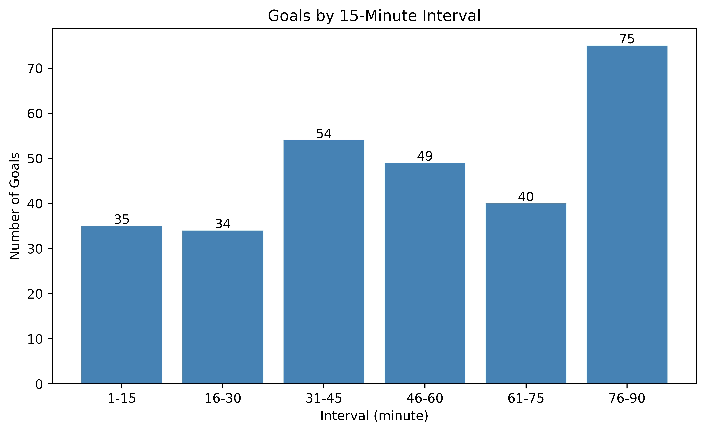

# Football-Goal-Distribution

Using Python (**pandas** + **matplotlib**) to process the match-event database of the **2026 FIFA World Cup** and analyze **when** goals are scored during a football match.

## Overview

This project reads the match-event data, organizes the important events, extracts every goal, and analyzes how goals are distributed across the minutes of a match. As a football player and a Data Science & AI student, I wanted to test whether common beliefs — such as "more goals happen late in the game" or "stoppage time is the most dramatic period" — are actually supported by real data.

## Dataset

- **Source:** Kaggle — FIFA World Cup 2026 Dataset (Live & Updated Stats)
- **File used:** `match_events.csv`

| Column | Description |
|---|---|
| `event_id` | Unique ID for each event |
| `match_id` | Match identifier |
| `minute` | Minute when the event occurred |
| `event_type` | `Goal`, `Assist`, or `Other` |
| `team_id` | Team identifier |
| `player_id` | Player identifier |

- The file contains **601 events** in total, of which **294 are goals** (`event_type == 'Goal'`).

## Research Questions

1. Is the goal distribution evenly spread across the 90 minutes (in each minute)?
2. Which time period sees the most goals scored?
3. Is the distribution of goals even between the first and second halves?

## Tools & Method

- **pandas** — load the CSV, filter goals, check data quality (missing / duplicate / data types), and group goals by time (`apply`, `value_counts`, `pd.cut`).
- **matplotlib** — bar chart (per-minute and 15-minute intervals) and pie chart (first half / second half / extra time).

## Key Findings

Descriptive statistics for the 294 goals:

| Statistic | Value |
|---|---|
| Total goals | **294** |
| Mean goal time | **53.6 min** |
| Median goal time | **54.5 min** |
| Standard deviation | 27.9 min |
| Earliest goal | **2nd min** |
| Latest goal | **120th min** (extra time) |
| 25th percentile | 31 min |
| 75th percentile | 78 min |

1. **Goals are NOT evenly spread across the 90 minutes.** The per-minute chart shows two very sharp peaks: **14 goals recorded at minute 45 and 34 at minute 90**. These are stoppage-time goals, which the dataset records as whole numbers (45 and 90) — they are not sudden bursts of regular goals.

2. **The periods just before half-time and full-time are the highest.** In the 15-minute interval chart, the **31–45** and **76–90** bars are the tallest, partly because they include the 45'/90' stoppage-time goals. *(Fill in the exact count of each bar from the chart if you want exact numbers.)*

3. **More goals are scored in the second half.** The mean (53.6) and median (54.5) are both above 45 minutes, and the pie chart shows the **Second Half** holding the largest share. This is likely related to fatigue, tactical changes, and teams pushing for a result late in the game — a possible cause, not something the data proves directly.

4. Goals range from the **2nd minute** (an early opener) to the **120th minute** (an extra-time winner), showing both "lightning" starts and last-gasp winners.

## Visualizations

### 1. Goal distribution by minute


Goals are spread across the match, but with two clear stoppage-time peaks at minutes 45 and 90.

### 2. First half vs second half vs extra time


The second half accounts for the largest share — **First Half XX% / Second Half XX% / Extra Time XX%** *(replace the XX with the percentages shown on your pie chart)*.

### 3. Goals by 15-minute interval


The 31–45 and 76–90 intervals are the highest, again driven by stoppage-time goals.

## How to Run

1. Install the required libraries:

```bash
pip install pandas matplotlib
```

2. Place `match_events.csv` in the same folder as the script.

3. Run the script:

```bash
python analysis.py
```

## Project Structure

```
Football-goal-distribution/
├── match_events.csv          # Raw event data
├── analysis.py               # Analysis script
├── goal_distribution.png     # Per-minute bar chart
├── half_comparison.png       # Pie chart of halves
├── interval_analysis.png     # 15-minute interval chart
└── README.md
```

## What I Learned

- Loading and filtering CSV data with pandas (`read_csv`, boolean indexing).
- Basic data-cleaning checks (`isnull`, `duplicated`, `dtypes`).
- Grouping data with `apply`, `value_counts`, and `pd.cut`.
- Building bar charts and pie charts with matplotlib.
- Recognizing a domain-specific data quirk — stoppage-time goals recorded as minutes 45 and 90.
- Turning charts into evidence-based conclusions, and separating facts from likely causes.

## Acknowledgements

- Dataset: **FIFA World Cup 2026 Dataset** on Kaggle.
- Built as a learning project while studying Data Science & AI at Hong Kong Metropolitan University.
